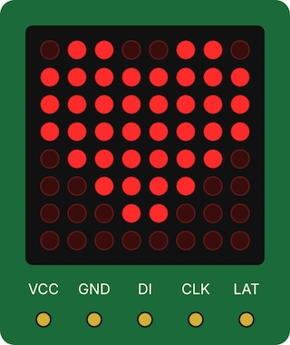
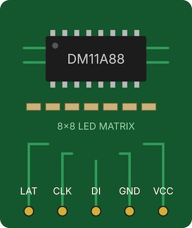
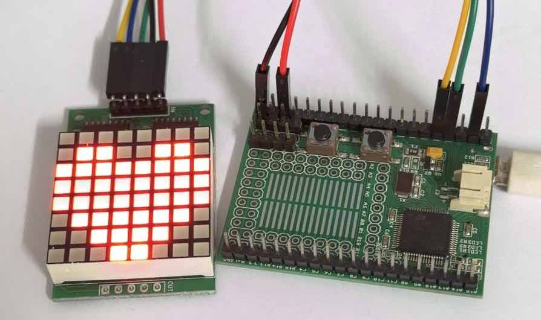

<!--- Copyright (c) 2026 Mark Becker. See the file LICENSE for copying permission. -->
DM11A88 8x8 LED matrix driver
==============================

<span style="color:red">:warning: **Please view the correctly rendered version of this page at https://www.espruino.com/DM11A88. Links, lists, videos, search, and other features will not work correctly when viewed on GitHub** :warning:</span>

Espruino module for the **DM11A88** 8x8 LED matrix driver adds buffered multiplexing for Espruino Graphics support.

<table>
  <tr>
    <td align="center"><br><sub>Front</sub></td>
    <td align="center"><br><sub>Back</sub></td>
    <td align="center"><br><sub>Heart</sub></td>
  </tr>
</table>

*Schematic illustration. Pin order and layout may differ on your board.*

## How it works

The DM11A88 lights **one row at a time**. For each device two bytes are shifted out (MSB first): the row select (active low) and the 8 column bits. The module keeps a frame buffer and scans all 8 rows in the background, so the picture appears steady. Shifting uses a configured Espruino SPI instance, which avoids the flicker caused by slow `digitalWrite()` bit-banging. For module details see [DM11A88.js](DM11A88.js).

## Wiring

| Module | Espruino pin |
|--------|--------------|
| VCC    | 3.3 V / 5 V (as per your board) |
| GND    | GND |
| DI     | SPI MOSI pin |
| CLK    | SPI SCK pin |
| LAT    | Latch / CS pin (`lat`) |

Software
--------

```js
var DM11A88 = require("DM11A88");
SPI = new SPI();
SPI.setup({ mosi: B5, sck: B3, baud: 8000000 });

const g = DM11A88.connect({
  spi: SPI,
  lat: B6,
  modules: 1,
  interval: 1.5,
  reverseOrder: false
});

var heart = { width: 8, height: 8, bpp: 1, transparent: 0, buffer: new Uint8Array([
  0b00000000,
  0b01100110,
  0b11111111,
  0b11111111,
  0b11111111,
  0b01111110,
  0b00111100,
  0b00011000
]).buffer };

g.clear();
g.drawImage(heart, 0, 0);
```

## Options

| Option         | Description                                     | Default |
|----------------|-------------------------------------------------|---------|
| `spi`          | Configured SPI instance (required)              | -       |
| `lat`          | Latch / CS pin (required)                       | -       |
| `modules`      | Number of cascaded 8x8 modules                  | `1`     |
| `interval`     | Row scan interval in ms (min `0.5`)             | `1.5`   |
| `reverseOrder` | Set `true` if modules are wired right-to-left   | `false` |

## API

`connect(options)` returns an Espruino `Graphics` instance (`8 * modules` x `8`, 1-bit) with scanning already started, plus the following control methods:

| Method | Description |
|--------|-------------|
| `g.start()` | Starts the background row scan timer (returns `g`). |
| `g.stop()` | Stops the scan timer and turns off all rows and columns (returns `g`). |
| `g.setScanInterval(ms)` | Updates the row scan interval in ms, clamped to a minimum of `0.5` ms (returns `g`). |

## Notes

- Module `0` is the leftmost 8 columns by default
- Use `reverseOrder: true` if chained right-to-left, or `g.setRotation(n)` for other orientations.
- Because `g` writes directly to the underlying array buffer, changes appear on the display immediately without needing `g.flip()`.
- If the display flickers, try increasing the SPI `baud` rate or lowering the scan interval via `g.setScanInterval(1)`.
