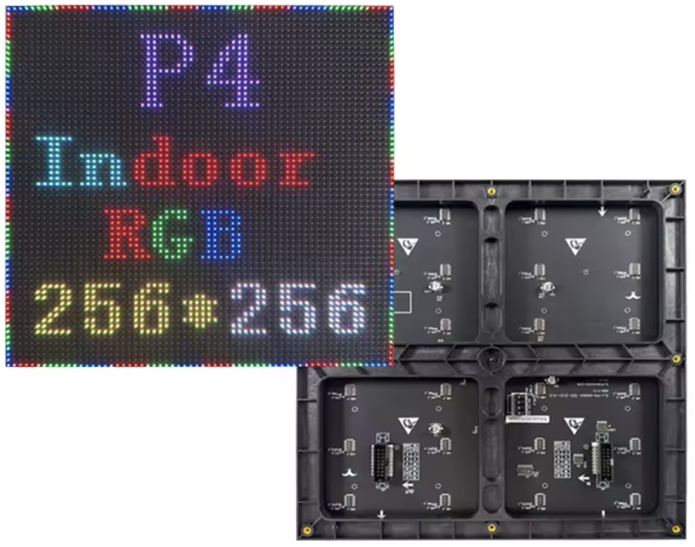
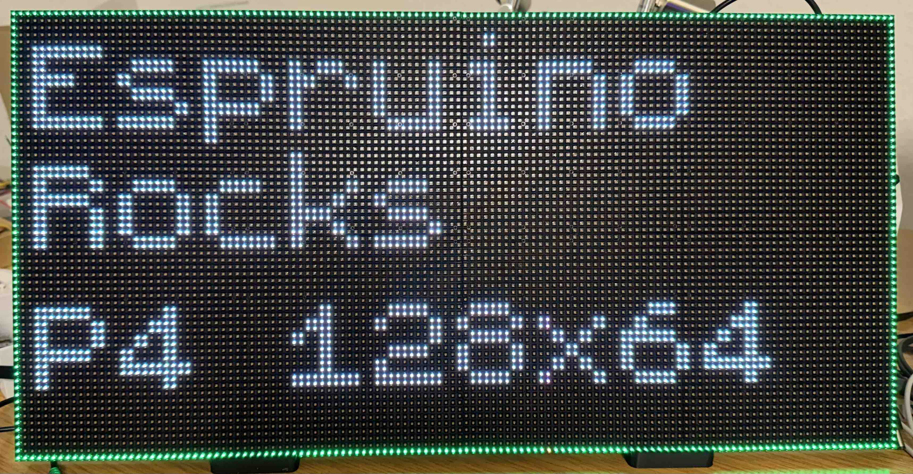
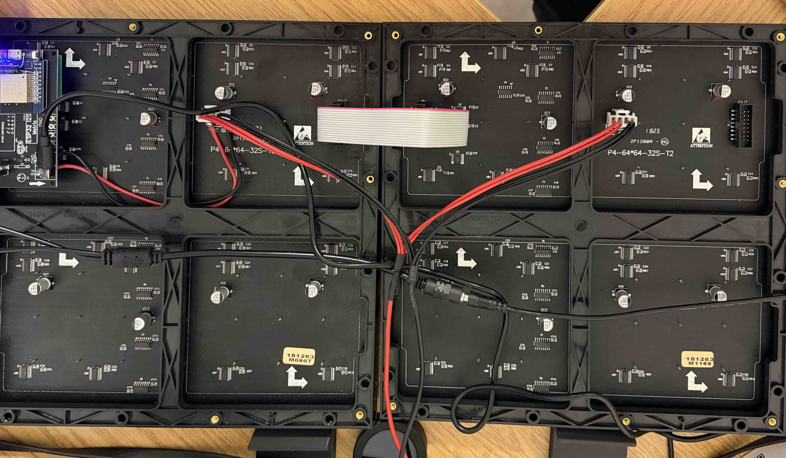

# FM6126 RGB LED Matrix driver

This is the driver for the FM6126-based RGB LED Matrix panels (typically HUB75 panels, e.g., 64x64). It features high-refresh-rate driving via shift registers and dual-buffered Espruino Graphics integration.

<span style="color:red">:warning: **Please view the correctly rendered version of this page at https://www.espruino.com/FM6126. Links, lists, videos, search, and other features will not work correctly when viewed on GitHub** :warning:</span>

Support is included in the [[FM6126.js]] module, using the built-in Espruino [[Graphics]] library.

## Hardware Examples

Typical 64x64 panels come with a standard HUB75 input and output interface on the back:



Two panels can also be connected together to create a 128×64 display.



## Wiring

The driver requires full control over the HUB75 interface pins. Below is an example wiring diagram for standard Espruino boards (such as an ESP32 or STM32 variant).

| Panel Pin         | Pin Type                   | Espruino Names        | ESP32 Names            |
| :---------------- | :------------------------- | :-------------------- | :--------------------- |
| **A, B, C, D, E** | Row Scan Address lines     | B8, C8, C6, B9, C12   | D19, D23, D18, D5, D15 |
| **R1, G1, B1**    | Top Half RGB Data lines    | B3, B5, B4            | D13, D21, D12          |
| **R2, G2, B2**    | Bottom Half RGB Data lines | B6, C11, C10          | D27, D17, D4           |
| **LAT**           | Latch / STB                | C9                    | D22                    |
| **OE**            | Output Enable (Active Low) | B7                    | D2                     |
| **CLK**           | Shift Clock                | C26 (or matching clk) | D14                    |
| **GND**           | Ground                     | GND                   | GND                    |


Software
-------

The module utilizes an internal `ArrayBuffer` graphics context. To display changes made via drawing operations, the internal timer continuously refreshes the panel in the background.

Espruino board:

```js
var options = {
  width: 64,
  height: 64,
  brightness: 50, 
  interval: 15, 
  A: B8, B: C8, C: C6, D: B9, E: C12,
  R1: B3, G1: B5, B1: B4,
  R2: B6, G2: C11, B2: C10,
  LAT: C9, OE: B7, CLK: C26
};
```
ESP32 board:
```js
var options = {
  width: 64,
  height: 64,
  brightness: 50,
  interval: 15, 
  A: D19, B: D23, C: D18, D: D5, E: D15,
  R1: D13, G1: D21, B1: D12,
  R2: D27, G2: D17, B2: D4,
  LAT: D22, OE: D2, CLK: D14,
};
```

Initialize and start the matrix using method chaining:
```

var panel = require("FM6126").connect(options).init().start();

// Get the graphics instance to perform drawing operations
var g = panel.g;

// Draw a static pattern
g.setColor(GREEN).drawRect(0,0,63,63);
g.setColor(WHITE).setFont("6x8")
g.drawString("Espruino",3,3)
g.drawString("Rocks",3,20)
g.drawString("P4 128x64",3,40);
```

### Dimensions

The driver supports different panel dimensions through the width and height configuration options.

64×64 panel:
```js

require("FM6126").connect({
  width: 64,
  height: 64,
  // additional pin configuration
});
```
128×64 panel (two 64×64 panels connected together):
```
require("FM6126").connect({
  width: 128,
  height: 64,
  // additional pin configuration
});
```
The required row address signals depend on the panel's scanning architecture. Typical 64×64 panels use five address lines (A–E), while smaller panels may use fewer.

Make sure that the configured dimensions and address pins match the actual panel hardware.


### Brightness

The panel brightness can be changed dynamically at runtime. Brightness values are specified as percentages, from 0 to 100. The driver converts these values into the corresponding hardware brightness settings.

```js
// Set brightness to 25%
panel.setBrightness(25);
```
Brightness updates are handled by the driver to minimize interruptions to the display refresh process.

### Power Control

The driver provides methods to control background display refreshing.

```js
// Stop background refresh driving
panel.stop();

// Clear graphics buffer
panel.clear();

// Resume matrix rendering
panel.start();
```
Stopping the refresh mechanism can reduce microcontroller activity.

Calling clear() clears the graphics buffer. The physical panel will display the cleared image once refreshing resumes.