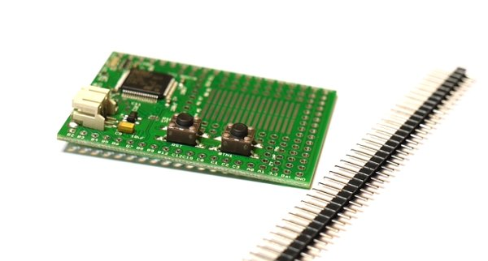

<!--- Copyright (c) 2013 Gordon Williams, Pur3 Ltd. See the file LICENSE for copying permission. -->
Pin and Socket Strip
====================

:warning: **Please view the correctly rendered version of this page at https://www.espruino.com/Pin+Strip. Links, lists, videos, search, and other features will not work correctly when viewed on GitHub** :warning:

* KEYWORDS: Pin,Pins,Socket,Strip,0.1,Dupont,Header

If you're trying to prototype something, it's often handy to be able to plug and unplug it. The video below shows you how to solder Pin Strip on to the Espruino Board.

[[http://youtu.be/ArQKxe7X_q4]]

And how to solder connections suitable for [Servo Motors](Servo Motors.md).

[[http://youtu.be/9KX32jrSZts]]

Don't want to solder?
-------------------

You can buy solderless pin headers (see below). They're a little more expensive, but they just push right in!

Buying
-----

* [eBay Pin Strip](https://www.ebay.com/sch/i.html?_nkw=0.1+pin+strip)
* [eBay Jumper wires](https://www.ebay.com/sch/i.html?_nkw=female+dupont+jumper+wire)
